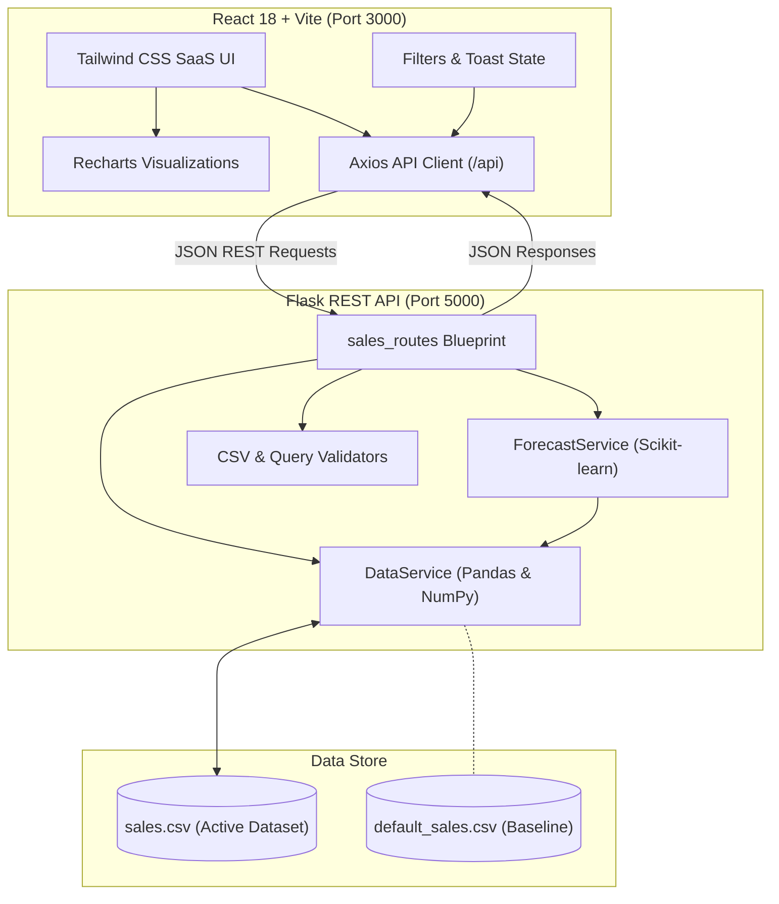

# 📊 SalesPulse: Sales Data Analysis & Revenue Forecasting Dashboard

A full-stack, enterprise-grade business intelligence and revenue forecasting platform. Built with a modern **React (Vite) + Tailwind CSS** frontend, a high-performance **Python (Flask)** REST backend, and **Scikit-learn** predictive analytics.

---

## 📑 Table of Contents
1. [Overview & Highlights](#-overview--highlights)
2. [Key Features](#-key-features)
3. [Technology Stack](#-technology-stack)
4. [System Architecture](#-system-architecture)
5. [Folder Structure](#-folder-structure)
6. [Quick Start & Running the Project](#-quick-start--running-the-project)
7. [API Documentation](#-api-documentation)
8. [CSV Dataset Ingestion & Validation](#-csv-dataset-ingestion--validation)
9. [Machine Learning & Forecasting Model](#-machine-learning--forecasting-model)
10. [Future Roadmap](#-future-roadmap)

---

## 🌟 Overview & Highlights

SalesPulse is a complete, production-ready Sales Analytics Dashboard designed following modern SaaS design aesthetics (Stripe, Linear, and modern BI dashboards). Unlike static mockups, every visual component, KPI card, and Recharts graph is dynamically computed and served by a Python backend using **real statistical analysis and Machine Learning**.

- **Zero Mock Statistics**: All 6 KPI metrics, percentage comparisons, distributions, and predictions reflect actual dataset transactions.
- **Scikit-learn ML Forecasting**: Employs chronological holdout validation, calculating real **Mean Absolute Error (MAE)** and **Root Mean Squared Error (RMSE)** metrics to forecast forward revenues with 80% prediction bounds.
- **Dynamic CSV Ingestion Engine**: Allows users to drag-and-drop custom sales CSV files, validating schema headers, data types, and filtering anomalies in real time without silent data corruption.
- **Enterprise UI/UX**: Designed with a clean light theme, soft background (`#f8fafc`), crisp card elevation, custom hover transitions, skeleton loaders, and live toast notifications.

---

## 🚀 Key Features

### 1. Executive Overview Dashboard
- **6 Primary KPI Cards**: Total Revenue, Total Sales Records/Orders, Total Units Sold, Average Order Value (AOV), Active Products, and Category Depth.
- **Period-over-Period Comparisons**: Automatically compares selected timeframe against previous equal periods with visual positive/negative badges.
- **Interactive Visualizations**: Monthly revenue area chart, category revenue distribution donut, and 30-day daily sales trend.
- **Top 5 Revenue Drivers**: Instant preview table of top-performing products.

### 2. Deep Sales Analytics
- **Dual-Axis Composed Chart**: Simultaneously correlates monthly revenue ($) against transaction volume (orders count).
- **Daily Volatility Monitor**: Smooth 60-day area graph highlighting intra-week and weekend sales fluctuations.
- **Average Order Value (AOV) Progression**: Tracks basket size trends across quarters.
- **Category Matrix Table**: Formatted breakdown of gross revenue, market percentage share, and total units sold.

### 3. Product Performance Analytics
- **Top 10 by Revenue**: Horizontal bar chart identifying core profit drivers.
- **Top 10 by Units Sold**: Highlights fast-moving inventory items.
- **Interactive Catalogue Ledger**: Search products by name or category with multi-column sorting (Units, Price, Revenue, Orders).

### 4. Machine Learning Revenue Forecasting
- **Linear Regression Model**: Fitted on aggregated monthly time-series using Scikit-learn Ordinary Least Squares (OLS).
- **Time-Series Evaluation**: Strict chronological split (preventing future lookahead leakage) outputting MAE, RMSE, and R² scores.
- **Next 3-Month Forward Projection**: Generates explicit monthly forecasts accompanied by 80% confidence interval upper and lower limits.
- **Interactive Comparison Chart**: Compares historical actuals, fitted regression trendline, and forward forecasts.
- **Educational Explanations & Disclaimers**: Built-in documentation accordion and responsible AI disclosure.

### 5. Transaction Records Ledger
- Complete searchable and filterable sales transaction table.
- Live search query filter by product name or category.
- Server-side sorting by Date, Product, Category, Quantity, Unit Price, and Revenue.
- Pagination controls with customizable page sizes (15, 30, 50, 100).
- One-click **Export to CSV** for offline spreadsheet analysis.

### 6. CSV Dataset Manager
- Drag-and-drop upload zone for custom sales datasets.
- Schema verification validating required columns (`date`, `product`, `category`, `quantity`, `price`).
- Safety confirmation modal before replacing the dataset.
- Real-time ingestion report displaying valid rows imported, rows rejected, and total sales loaded.
- Built-in **Sample CSV Template Download** and **Restore Baseline Dataset** action.

---

## 🛠 Technology Stack

### Frontend
- **Framework**: React.js (v18) bootstrapped with **Vite**
- **Styling**: Tailwind CSS with custom typography (Plus Jakarta Sans & Inter)
- **Data Visualization**: Recharts (ResponsiveContainer, AreaChart, BarChart, ComposedChart, PieChart)
- **Icons**: Lucide React
- **HTTP Client**: Axios (configured with base URL and timeout handling)

### Backend
- **Framework**: Python 3.10+ / Flask REST API
- **Cross-Origin Handling**: Flask-CORS
- **Data Processing**: Pandas & NumPy
- **Machine Learning**: Scikit-learn (LinearRegression, MAE, RMSE, R²)
- **Dataset Storage**: File-based CSV architecture (prepared for SQLite / PostgreSQL adapters)

---

## 🏛 System Architecture



---

## 📁 Folder Structure

```
Sales Data Analysis Dashboard/
│
├── frontend/                               # React + Vite Client
│   ├── public/                             # Static assets & icons
│   ├── src/
│   │   ├── components/                     # Reusable UI components
│   │   │   ├── ConfirmModal.jsx            # Danger & confirmation modal
│   │   │   ├── KpiCard.jsx                 # Executive metric card with badges
│   │   │   ├── LoadingSkeleton.jsx         # Skeleton pulse animations
│   │   │   ├── Navbar.jsx                  # Top navigation & global filter bar
│   │   │   ├── Sidebar.jsx                 # Modern responsive sidebar
│   │   │   └── Toast.jsx                   # Alert notification manager
│   │   ├── pages/                          # Primary view containers
│   │   │   ├── OverviewPage.jsx            # Executive KPI & chart dashboard
│   │   │   ├── SalesAnalyticsPage.jsx      # Deep dive sales analytics
│   │   │   ├── ProductPerformancePage.jsx  # Top products & catalogue table
│   │   │   ├── ForecastPage.jsx            # Scikit-learn ML forecasting
│   │   │   ├── TransactionsPage.jsx        # Searchable paginated ledger
│   │   │   └── DataManagerPage.jsx         # CSV upload & dataset manager
│   │   ├── services/
│   │   │   └── api.js                      # Centralized Axios API service
│   │   ├── utils/
│   │   │   └── formatters.js               # Currency, number & date formatting
│   │   ├── App.jsx                         # Main app state coordinator
│   │   ├── index.css                       # Tailwind directives & scrollbars
│   │   └── main.jsx                        # React root entrypoint
│   ├── index.html                          # HTML template
│   ├── package.json                        # Frontend dependencies
│   ├── tailwind.config.js                  # Tailwind configuration
│   └── vite.config.js                      # Vite server & API proxy config
│
├── backend/                                # Python Flask Server
│   ├── app/
│   │   ├── models/
│   │   │   └── sales_model.py              # Data structures & serialization
│   │   ├── routes/
│   │   │   └── sales_routes.py             # REST API endpoints
│   │   ├── services/
│   │   │   ├── data_service.py             # Pandas filtering, metrics & ingestion
│   │   │   └── forecast_service.py         # Scikit-learn ML regression & evaluation
│   │   ├── utils/
│   │   │   └── validators.py               # CSV validation & date standardizer
│   │   └── __init__.py                     # Flask application factory & CORS
│   ├── data/
│   │   ├── sales.csv                       # Active dataset (18 months, ~4,400 rows)
│   │   └── default_sales.csv               # Baseline backup dataset for resets
│   ├── app.py                              # Backend startup entrypoint
│   ├── generate_data.py                    # Deterministic realistic data generator
│   ├── requirements.txt                    # Python package dependencies
│   └── test_backend.py                     # Integration test suite
│
├── run_all.bat                             # One-click Windows starter (Both servers)
├── run_backend.bat                         # Start Flask backend on Port 5000
├── run_frontend.bat                        # Start React frontend on Port 3000
├── .gitignore                              # Git exclusion rules
└── README.md                               # Project documentation
```

---

## ⚡ Quick Start & Running the Project

### Option A: One-Click Launch (Windows)
Double-click `run_all.bat`. This automatically launches both the backend and frontend in separate command windows and opens:
- **Frontend UI**: [http://localhost:3000](http://localhost:3000)
- **Backend API**: [http://127.0.0.1:5000/api/health](http://127.0.0.1:5000/api/health)

---

### Option B: Manual Setup

#### 1. Backend Setup
1. Open a terminal in the project root:
   ```bash
   cd backend
   ```
2. Create and activate a Python virtual environment:
   - **Windows**:
     ```powershell
     python -m venv venv
     .\venv\Scripts\activate
     ```
   - **macOS / Linux**:
     ```bash
     python3 -m venv venv
     source venv/bin/activate
     ```
3. Install dependencies:
   ```bash
   pip install -r requirements.txt
   ```
4. Verify backend services and run the test suite:
   ```bash
   python test_backend.py
   ```
5. Start the Flask server:
   ```bash
   python app.py
   ```
   *Backend will run on `http://127.0.0.1:5000`.*

#### 2. Frontend Setup
1. In a separate terminal, navigate to the `frontend` folder:
   ```bash
   cd frontend
   ```
2. Install dependencies:
   ```bash
   npm install
   ```
3. Start the Vite development server:
   ```bash
   npm run dev
   ```
4. Open [http://localhost:3000](http://localhost:3000) in your browser.

---

## 📡 API Documentation

All endpoints return standardized JSON payloads with HTTP 200/400/500 status codes.

| Method | Endpoint | Query Parameters | Description |
| :--- | :--- | :--- | :--- |
| `GET` | `/api/health` | None | Service health check |
| `GET` | `/api/overview` | `start_date`, `end_date`, `category` | Executive KPIs with period comparison |
| `GET` | `/api/monthly-sales` | `start_date`, `end_date`, `category` | Monthly aggregated revenue and order counts |
| `GET` | `/api/daily-sales` | `start_date`, `end_date`, `category`, `limit_days` | Daily revenue series |
| `GET` | `/api/category-sales`| `start_date`, `end_date` | Category revenues and percentage shares |
| `GET` | `/api/top-products` | `start_date`, `end_date`, `category`, `limit` | Top products by revenue and quantity |
| `GET` | `/api/recent-sales` | `page`, `page_size`, `search`, `category`, `sort_by`, `sort_order` | Paginated transaction ledger |
| `GET` | `/api/categories` | None | Unique active category strings for dropdowns |
| `GET` | `/api/forecast` | `category`, `horizon` (default 3) | Scikit-learn Linear Regression model & forecasts |
| `POST`| `/api/upload` | Multipart Form: `file` (.csv) | Ingests, validates, and sets active sales dataset |
| `POST`| `/api/reset` | None | Restores active dataset to baseline 18-month data |
| `GET` | `/api/export` | `start_date`, `end_date`, `category`, `search` | Downloads filtered dataset as CSV file |

---

## 📥 CSV Dataset Ingestion & Validation

When uploading custom data via `/api/upload` or the UI Data Manager, the file must contain the following 5 columns:

| Column | Type | Constraints | Description |
| :--- | :--- | :--- | :--- |
| `date` | String / Date | Valid ISO or common date | Transaction date (e.g. `2025-04-12`) |
| `product` | String | Non-empty string | Product name or SKU |
| `category` | String | Non-empty string | Product grouping (e.g. `Electronics`, `Fashion`) |
| `quantity` | Integer | Positive integer > 0 | Units sold |
| `price` | Float | Non-negative decimal >= 0 | Unit selling price ($) |

### Sample CSV Structure
```csv
date,product,category,quantity,price
2025-01-05,Wireless Noise-Canceling Headphones,Electronics,2,149.99
2025-01-08,Classic Denim Jacket,Fashion,1,68.50
2025-01-12,Ceremonial Grade Matcha Powder 100g,Grocery,3,18.99
2025-01-15,Ergonomic Lumbar Office Chair,Home,1,249.00
2025-01-18,Hardcover Dotted Grid Journal A5,Stationery,4,15.50
```

---

## 🧠 Machine Learning & Forecasting Model

### Algorithm Choice: Ordinary Least Squares (OLS) Linear Regression
For monthly sales trend forecasting, **Linear Regression** provides clear explainability, predictable extrapolation, and resistance to overfitting on small-sample monthly series ($N \approx 12 - 36$ months).

The model computes:
$$\hat{y} = \beta_0 + \beta_1 x$$

Where:
- $x$: Chronological month index ($0, 1, 2, \dots, N-1$).
- $\hat{y}$: Projected monthly revenue in USD.
- $\beta_1$: Estimated monthly revenue growth velocity ($\Delta \text{Revenue} / \text{Month}$).
- $\beta_0$: Regression baseline intercept.

### Evaluation Methodology
Rather than standard randomized K-Fold cross-validation (which violates time-series temporal ordering), SalesPulse uses **Chronological Holdout Validation**:
1. The historical timeline is partitioned into an earlier **training period** ($N - 3$ months) and a recent **holdout testing period** (last 3 months).
2. The model fits on the training months and predicts revenues on the holdout months.
3. Model evaluation metrics are calculated on the holdout period:
   - **Mean Absolute Error (MAE)**:
     $$\text{MAE} = \frac{1}{k} \sum_{i=1}^{k} |y_i - \hat{y}_i|$$
   - **Root Mean Squared Error (RMSE)**:
     $$\text{RMSE} = \sqrt{\frac{1}{k} \sum_{i=1}^{k} (y_i - \hat{y}_i)^2}$$
4. Once evaluated, the model fits across the entire dataset to project future months with approximate 80% prediction intervals:
   $$\hat{y}_{\text{future}} \pm 1.28 \cdot \sigma_{\text{residuals}}$$

---

## 🔮 Future Roadmap
- [ ] Database storage integration (SQLite / PostgreSQL with SQLAlchemy)
- [ ] Multi-model forecasting comparison (Linear Regression vs Facebook Prophet vs SARIMAX)
- [ ] User authentication, roles, and multi-tenant workspace isolation
- [ ] Automated scheduled email reports & PDF summary generation
- [ ] Direct export to Excel (.xlsx) with embedded formula sheets

---

## 📄 License
This project is open-source and available under the MIT License.
